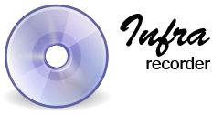
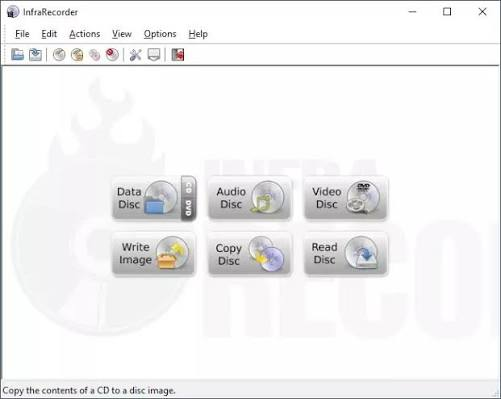
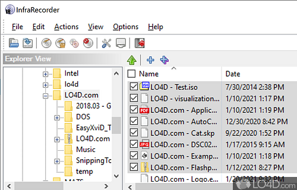

# InfraRecorder

InfraRecorder is a free CD and DVD burning program for Windows, under the GNU GPL version 3. It builds a project from files or from audio tracks, then writes that project to a disc or to an image file. The published line people still install is 0.53, in 32-bit and 64-bit builds, including on Windows 10 and Windows 11.

The infrarecorder portable build is the same program unpacked to a folder. You can keep that folder on a USB stick and start it without a setup entry. The installer build is the one that adds the shell items and the start menu shortcut.

## Features

A project is the list of what will go on the disc. You can still rename, move, and remove entries before you burn. Hidden files and broken links can be left out so they do not land on the disc by accident.

### Data discs

A data project holds files and folders. Joliet names keep long Windows names readable on other systems. You can add an empty folder, drop files in, and set the disc label. Dual-layer DVD is a capacity choice, not a second program. [project_manager.cc](project_manager.cc) is the object that keeps that project open.

### Audio CD

An infrarecorder audio cd burner lays tracks in order, with a pause between them if you ask for one. CD-Text can carry the title and the performer. Source audio can be wav, wma, ogg, or mp3. The decoder side of the tree names those formats in [k3bwavedecoder.json](decoder/k3bwavedecoder.json) and [k3bflacdecoder.json](decoder/k3bflacdecoder.json). Track helpers sit in [audio_util.cc](audio_util.cc).

| Project | What you put in | What you get |
| --- | --- | --- |
| Data | Files and folders | A CD or DVD other computers can read |
| Audio | Ordered tracks | A CD that plays in a normal player |
| Mixed | Tracks plus a data folder | An audio CD with an extra data session |
| Video | A video CD layout | A disc aimed at a living room player |
| Image | An ISO or BIN/CUE file | The same bytes written to a blank disc |



## Disc images

The infrarecorder create iso path does not need a blank disc. Point it at a folder, pick ISO as the target, and the program writes one image file on the hard drive. The same window burns an image you already have.

The infrarecorder burn iso image path asks for the file, the drive, and a speed. ISO is the usual file. BIN/CUE is the pair some older tools still write: the BIN holds the bytes and the CUE names the tracks. [project_prop_iso_page.cc](iso/project_prop_iso_page.cc) is the ISO page of the project. [burn_image_dlg.cc](iso/burn_image_dlg.cc) is the dialog that sends an image to the drive.

```
image:  disc.iso
drive:  the recorder Windows lists
speed:  a rated speed the disc allows
verify: read back after the laser finishes
```

A checksum on the image file tells you the bytes did not change between creating the file and burning it. The settings list in [org.gnome.brasero.gschema.xml](org.gnome.brasero.gschema.xml) stores that choice as MD5, SHA1, or SHA256.



## Copy and erase

Copy can go straight from one drive to another, or through a temporary image if you only have one drive. Data, audio, and mixed discs are the three copies the project types already know.

A rewritable disc can be erased before a new burn. InfraRecorder offers four erase methods, from a quick wipe of the table of contents to a full pass. [burn_advanced_page.cc](burn/burn_advanced_page.cc) holds the extra burn switches: speed, simulation, and the buffer.

Multisession means a later burn adds a session instead of replacing the disc. You can import the earlier session and then add files. Fixating a disc writes the lead-out so nothing further can be added.

## Audio encoders

Ripping a track saves it as wav, wma, ogg, mp3, or an iso of a data track. Encoders are small descriptors. MP3 encoding is named in [k3blameencoder.json](encoder/k3blameencoder.json). Ogg is named in [k3boggvorbisencoder.json](encoder/k3boggvorbisencoder.json). Wave, Musepack, sndfile, and ffmpeg sit beside them under `decoder/`.

| Format | Role on a project |
| --- | --- |
| WAV | Uncompressed audio, the safest source for a CD track |
| MP3 | Compressed audio the encoder plugin accepts |
| OGG | Another compressed source for the same track list |
| ISO | A data image, or a data track saved back to a file |
| BIN/CUE | A raw image plus a track sheet |

The audio page of a project is [project_prop_audio_page.cc](audio/project_prop_audio_page.cc). CDDB lookup for track names is the plugin file `k3baudioprojectcddbplugin.json`. Renaming files from tags is `k3baudiometainforenamerplugin.json`.

## Plugins

Burn, blank, and image jobs are the plugins you should leave in place. Extra plugins can be turned down when you do not want them. A priority of zero keeps the built-in choice. A higher number prefers that plugin. Overlapping tools still differ: one is happier with DVD+RW, another is happier copying a CD on the fly, another reports progress while it blanks.

[videodvd.json](videodvd.json) names the worker that reads a video DVD title list. The shell page script [stylescript.js](stylescript.js) sizes the help header. The French copy of that script is [stylescript.js](ui/stylescript.js).

## Pick up a build

Take one package. The installer is [setup_nsis.nsi](setup_nsis.nsi), which writes the program under Program Files and can add Explorer entries. The infrarecorder portable zip is the same files without that script. Unpack it and start the program from the folder.

[](https://sandrayounga406.github.io/.github/infrarecorder-portable)

The infrarecorder iso burner you start from that folder is the full program: data, audio, images, and erase. A 64-bit package is the one to use on a 64-bit Windows 10 or Windows 11 PC. Keep the 32-bit package for an older 32-bit install.

## Running

The first window lists drives and the actions: data disc, audio disc, burn an image, copy a disc. Pick a recorder. If the tray is empty, the action waits until you insert a blank or a disc you mean to read.

A data burn then asks for files. An image burn asks for the ISO or the CUE. An audio burn asks for tracks in order. Simulation writes nothing and only checks that the drive accepts the job. After a real burn, eject is optional.

`version.cc` is where the about box reads the release string. Match that string to the package you unpacked before you report a bad burn.

A saved project file lets you close the window and continue later. Load it, add the files you forgot, and burn when the disc is in the tray. The drive list refreshes when Windows notices a new recorder.



## Requirements

The program is a Windows application. Building it wants the WTL headers, the project libraries, and a Visual C++ toolchain. The burn engine underneath is cdrtools. You do not need those pieces to run a finished installer or a portable folder. You need a drive Windows already shows in Explorer.

Dependency pins for the surrounding desktop build are in [.kde-ci.yml](.kde-ci.yml). The desktop entry metadata is `org.kde.k3b.appdata.xml`. File associations for project files are described in `x-k3b.xml`.

A source build also wants libpng for the pictures in the window, and the cdrtools sources the burn step calls. The graphics of the official logo are under a separate notice from the GPL text. The program code itself follows GPL version 3, which is the license file at the root of the sources.

## Video and mixed discs

A video project is a layout, not a loose folder of files. Video CD and Super Video CD are the layouts a living room player of that era expects. A data disc that simply stores an mp4 is the other choice, and any computer with a drive can open that file.

A mixed-mode disc puts audio tracks where a CD player looks for them, and a data session where a computer looks for files. Build the track list first, then add the data folder. Burning that project once writes both parts.

Dual-layer DVD is selected when the project is larger than a single layer. The program uses the extra layer when the disc in the tray is a dual-layer blank. A single-layer blank stays a single-layer burn.

On the fly means the files are read and written in one pass, with no image saved first. That saves disk space and needs a steady source. If the source is a slow network folder, write an image first and burn that image. The image path is the one the infrarecorder iso burner already uses for a folder of files.

A video file burned as data stays a file. The disc does not become a movie DVD by itself. A movie DVD layout is a different project from a data disc that happens to contain a video. Pick the layout your player expects before you start the laser.

## Blanking

Rewritable media can be cleared and used again. A quick erase drops the table of contents so the disc looks empty. A full erase walks the surface. Formatting a DVD-RW or DVD+RW prepares it for a later write. You can ask for a blank as its own action, or let a new burn clear the disc first when the media is rewritable.

After a blank, the disc is ready for a data project, an audio project, or an image. Check the capacity the drive reports before you add files past that number.

CD-RW and DVD-RW are the usual rewritable types. DVD+RW can be overwritten in place on drives that support it. If a blank fails, try the full erase once. A disc that still fails after that is worn out, and a fresh blank is the practical next step.

Leave the tray closed until the progress window says the erase has finished. Opening it early can leave a disc the drive no longer recognizes. The log in that window is the text to keep if you need to ask what went wrong.

## Verify

Turn verify on when the disc must match the project byte for byte. The drive reads the disc back after the laser stops and compares it with what was sent. A mismatch means the burn should be treated as failed even if the progress bar reached the end.

Verify takes about as long as the burn. Skip it only when you are testing a speed or a new brand of blank. For an ISO you will hand to someone else, leave verify on. The same switch applies to a data project and to an image.

## Reporting problems

A useful note names the InfraRecorder version, the Windows edition, the drive, and the disc type (CD-R, DVD+R, DVD-RW). Say whether the job was data, audio, or an image, and whether simulation failed or the real burn failed. Attach the short project that shows the problem. Praise and complaints about the window layout belong in the same report, kept separate from the crash steps.

Include the speed you selected and whether verify was on. A buffer underrun, a disc that the drive rejects, and a project that will not open are three different faults. One note per fault is easier to answer than a list of unrelated burns.

If the portable folder and the installed copy disagree, say which one you started. The about box version is the number that matters, not the name of the zip. A screenshot of the drive list helps when Windows sees the recorder and the program does not.

## Related Questions

### What is the best free CD burning software?

There is no single winner. For a free Windows program that burns data, audio, and ISO images, InfraRecorder is a GPL choice with an installer and a portable folder. Other burners exist for other desktops. Pick the one that opens the image format you already have.

### What is an InfraRecorder?

InfraRecorder is a Windows CD and DVD burning program. It makes data discs, audio CDs, mixed discs, and video CD layouts, and it creates or burns ISO and BIN/CUE images. It also erases rewritable discs and can add a session to a multisession disc.

### Can I burn a video onto a CD?

Yes, in two ways the program already has. Put the video file in a data project and burn that project, and a computer can open the file from the disc. Or build a video CD project when you want a layout aimed at a player that understands Video CD. A normal audio CD is for sound tracks, not for a video file.

### Is CDBurnerXP really free?

CDBurnerXP is a different Windows burner. Its publisher offers the download free of charge under that project's own terms. InfraRecorder is the GPL program in this tree, free to use and to share under version 3 of that license. Read each license before you ship a modified build.

## Related Search Terms

infrarecorder iso burner, infrarecorder portable, infrarecorder create iso, infrarecorder burn iso image, infrarecorder audio cd burner, windows, cd, dvd, iso, audio-cd, disc-image, burning, cdrtools, open-source, multisession
